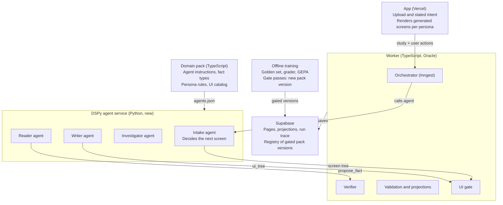

# Hive Agentic Architecture & Development Plan

Plan v1.1 · 2026-10-07 · Doc: https://claude.ai/code/artifact/99378acb-5a27-48cf-9238-67e2a80aba07

**Change record.** v1.1 (approved by AB, 2026-10-07): the UI is inverted for both personas and for intake, and Phase 8 starts after Phase 3, on v4 validated data. v1.0 (2026-10-07): plan adopted.

## Purpose and principles

Hive's core becomes a set of DSPy agents, defined and trained by each domain pack, with TypeScript code as the final judge of every fact and every screen.

- **Agents propose, code disposes.** Agents read, search, and propose facts, flags and layouts. A fact or a screen exists only after code checks it.
- **No chip, no claim.** Every fact carries a verbatim quote and its page, checked against the verbatim layer before it is accepted.
- **The domain pack is the definition and the training target.** Agent instructions, fact types, persona rules and the UI component list live in the pack. Training (DSPy GEPA) rewrites the pack's instructions and saves a new pack version.
- **One source of truth for checks.** The TypeScript verifier and grader are the only ones. The Python agents call them; they are never re-implemented.
- **Nothing ships unproven.** Every new piece runs in shadow beside the current v4 flow until the grader shows it is better on cases it was not trained on.
- **Two personas per domain.** A layperson (the parent, for IEP) and a professional (the advocate). Code decides what each must see; the Writer agent decides what comes first, how it is laid out and how it is worded.
- **Inverted UI.** No fixed pages or tabs. The evidence and the stated intent decide every screen, from the first screen after upload to the finished case.

## Target architecture

A new Python DSPy service runs the agents; the existing TypeScript worker stays the orchestrator and the only place where facts and screens are accepted.

The worker calls each agent as an Inngest step. The Reader's `propose_fact` goes back to the worker's verifier, and the Writer's `ui_tree` must pass the UI gate, as must the Intake agent's screen tree. A person's action on a screen goes back to the worker and produces the next tree. Training runs offline and publishes only versions that pass the gate.

## The agents

Four DSPy agents do the reading and writing; each has one code gate that decides whether its output counts.

| Agent | Input | Tools | Output | Code gate |
| --- | --- | --- | --- | --- |
| Intake | Uploaded documents, stated intent, pack evidence requirements | `list_documents`, `read_pages` | Screen tree for the next step: a question, a document request, or start reading | UI gate; requests limited to pack evidence requirements (`unmetIepEvidenceRequirements`) |
| Reader | Case pages, pack reading instructions | `list_documents`, `read_pages`, `search`, `propose_fact` (optional batch `propose_facts`) | Facts with quote and page, in the `/3` proposal shape | `propose_fact` checks every quote at its location inline; then `validate-proposal-v4` |
| Investigator | Flags from pack rules and `study/primitives` | Same as Reader | Each flag confirmed as a fact, resolved, or confirmed as a gap with pages searched | Same verifier; an absence needs a record of the pages searched |
| Writer | Validated case, persona, stated intent, pack UI rules | None (reads validated data only) | Screen tree: ordered catalog components with fact and item IDs, plus wording | UI gate: catalog components only, required items present, lead rules followed, every ID resolves, `checkTone` passes |

The orchestrator is the TypeScript worker: each agent call is one Inngest step, with caps on tool calls and dollars per case.

## Inverted dual-persona UI

There are no fixed pages or tabs: for every case, the evidence and the stated intent decide what each person sees and in what order, while code decides what must appear and every value shown.

**How a screen is made**

1. The worker sends the agent the validated case state, the persona and the stated intent. Before reading, the Intake agent makes the screen; after reading, the Writer does.
2. The agent returns a screen tree: an ordered list of catalog components, each carrying fact or item IDs and its wording.
3. The worker's UI gate checks the tree. On a pass it is saved as a `ui_tree` projection tagged with persona, catalog version and pack version. On a fail, code builds a fallback tree: the required items in the pack's priority order.
4. The app's page shell renders the tree and pulls every value from validated data by ID.
5. A person's action on a screen (an answer, an upload, a decision) goes back to the worker as an event, and the worker produces the next tree.

**What code fixes through the pack**

- **Required items per persona.** Parent: every conflict, change and gap. Advocate: the evidence ledger with source chips, and export. The advocate's tree varies by case, but these anchors are always present.
- **Lead rules.** For example: missing required evidence puts a document request first; a conflict comes before changes. The pack defines them; the gate enforces them.
- **Values by ID, catalog only, wording checks.** Values come from validated data, unknown components are rejected, and `checkTone`, banned phrases and the reading-level target apply to every text field.
- **Brand signature elements.** A source chip on every fact; the state bar (needs you, changed, missing, checked) in that order wherever counts are shown.

**Persona slots.** Every pack fills the same two slots, so the UI logic is the same in every domain.

| Domain | Layperson | Professional |
| --- | --- | --- |
| IEP | Parent or guardian | Advocate (attorney also, from `IEP_AUDIENCE_ROLES`) |
| Medicaid | Beneficiary or family | Caseworker or benefits advocate |
| Bankruptcy | Debtor | Attorney or trustee |

**Catalog (replaces the tabs).** Story block, fact card, change compare, gap note, question list, document request, decision prompt, timeline strip, state bar, source chip, PDF viewer with highlights, evidence ledger and export (advocate), and the IEP document explainer. Today's Story, Plan, Timeline and Meeting prep screens are broken into these components and stop being tabs.

**Delivery.** Trees are saved and rendered on load, not streamed: the study runs asynchronously on the worker, and a saved tree is reproducible and auditable.

**Training.** The Writer's metric is deterministic: required items present, lead rules followed, catalog components only, IDs resolve, tone passes, reading level in range. Ratings from real parents and advocates can be added later.

## Domain pack: definition and training target

The TypeScript pack stays the single source of truth; Python reads an exported copy and writes back only gated, versioned compiled programs.

| Pack part | Used as | Changed by training? |
| --- | --- | --- |
| `study.agents` instructions (Intake, Reader, Investigator, Writer) | DSPy signature instructions | Yes, by GEPA |
| Fact types and vocabulary | Signature output fields; quote and page required | No |
| Example extractions | DSPy demos | Optional |
| Rules and evidence requirements | Investigator flags; Intake requests | No |
| `ui` section: catalog, persona slots, required items, lead rules and advocate anchors per persona | Writer signature and the worker's UI gate | Writer wording and layout instructions only |
| Golden cases | Training and holdout sets | No (frozen) |

**Flow of artifacts**

1. `engine/domain-packs/iep/study/agents.ts` and the new `ui` section are edited by you in TypeScript.
2. `pnpm pack:export iep` writes `agents.json`, which the DSPy service loads.
3. Training compiles a program and runs the gate. Only on a pass is it saved to Supabase Storage (copy in git under `study/compiled/`) and listed in a gated-version registry table.
4. The study request carries a pinned version. The service loads it from the registry without a restart and refuses any version not in the registry.
5. The study fingerprint includes the compiled version, so a retrain forces a new run instead of reusing old results.

## Evaluation and training

GEPA trains the pack against one TypeScript grader that returns a score plus written feedback, and a code gate decides whether the result ships.

**Golden set.** L001–L006 with L007 as must-not-fire, plus one case with injected text. Proposed split, to confirm: tune L001, L002, L003, L005; holdout L004, L006; tripwire L007 and the injection case. Facts are anchored to word ranges in `document-pages` and matched by evidence overlap plus value, never by construct name (construct names are model-invented and vary between runs).

**Grader output.** A score, separate metrics (precision, recall, abstention, provenance, invariants), and feedback grouped by failure kind: `MISSED_FACT`, `UNSUPPORTED_CLAIM`, `VALUE_MISMATCH`, `WRONG_ABSTENTION`, `TRIPWIRE_FIRED`, `INVARIANT_BROKEN`, each with the expected and found quote and page. GEPA learns from this text, so a bare number is not enough.

**Score.** 0 if any tripwire fires; otherwise 0.5 × precision + 0.3 × recall + 0.2 × abstention. Precision carries the most weight because a wrong claim costs more than a missed one.

**Gate (code decides).** A trained version is accepted only if all tripwires pass, precision does not drop, holdout does not drop, and the tune score improves. Writer versions add: required items present and tone checks pass on every case.

**Where it runs.** Training runs offline. The grader is a CLI plus a local endpoint on 127.0.0.1 with a token, separate from the worker's public Inngest server. Recorded model calls (`recording-call-model.ts`) let reruns replay without cost.

## LLM call caching

Every model call puts its stable text first and marks it cacheable, so agent loops and retries pay full price for that text once per case instead of on every turn.

| What is cached | How | Where | Phase |
| --- | --- | --- | --- |
| System prompt and document attachments on single-shot calls (v4 study, story writer, retries) | Anthropic prompt caching on the stable prefix | `engine/model-providers/src/anthropic-call-model.ts` | 0 (T0.3) |
| Agent loop prefix: Hive rules, pack instructions, tool definitions; each turn only adds new text after it | Anthropic prompt caching; confirm DSPy passes cache markers through LiteLLM, else a thin custom LM wrapper | DSPy service LM setup | 3 |
| Case pages | Loaded into memory once per run; no repeated database reads | DSPy service | 3 |
| Shared case context across Reader, Investigator, Writer | Same text in the same position at the start of each agent's prompt, so one cached prefix serves all three | DSPy service prompt layout | 5 |
| Identical calls during training | DSPy response cache, keyed by pinned pack version so a retrained pack never gets an old answer | `agents/train.py`, service config | 5 |
| Training runs | Anthropic Batch API (discounted; check current rate) | `agents/train.py` | 5 |
| Grader and baseline reruns | Recorded calls replayed free | `shadow-golden/recording-call-model.ts` | 0–1 |

**Measured, not assumed.** The run trace records cached and uncached input tokens per call, and Phase 4's exit test reports the cache hit rate beside cost per case.

## Findings from the current code

The `refactor/engine-boundary` branch already holds much of what the plan needs, but four issues must be fixed first, starting with a prompt that contradicts its own schema.

| Finding | Where | Effect on the plan |
| --- | --- | --- |
| v4 prompt's "Runtime JSON contract" says single construct, `role`, `snippet`, no `gapKind`; the schema requires construct parts, `modality`, `quote`, `gapKind` | `engine/core/prompts/canonical-study/canonical-study-v4.md` vs `engine/shared/src/case-intelligence/4/openai-proposal-json-schema.ts` | Fix first (T0.1); every baseline depends on it |
| A non-"v4" prompt version silently runs the v3 engine | `worker/src/study/build-worker-study-deps.ts:122` | Fix in T0.1 |
| Pack does not build the study prompt; the prompt is a fixed file and the pack adds only vocabulary and focus constructs | `engine/core/src/prompts/load-canonical-study-prompt.ts` | Phase 2 moves agent instructions into the pack |
| Model receives PDFs as attachments, not the verbatim layer | `engine/core/src/study/openai-engine-v4.ts` | Reader tools serve `document-pages` text with word positions |
| One response must hold every fact, capped at 16,000 output tokens | `engine/model-providers/src/create-call-model-from-env.ts` | Fact-by-fact proposing removes the ceiling |
| `CallModel` is single-shot, no tools | `engine/shared/src/model/call-model.ts` | Agents run in DSPy; TypeScript keeps single-shot calls |
| Verifier and grader seeds exist | `validate-document-evidence.ts`, `document/find-consecutive-word-quote.ts`, `study/shadow/compare-v4.ts` | Reused, not rewritten |
| Golden record/replay exists | `engine/core/scripts/shadow-golden/` | Grader builds on it |
| Worker server is public (`/api/inngest`) | `worker/src/main.ts` | Grader and verifier endpoints use a separate localhost listener |
| Only `l001` and `caleb9` corpora are in the repo | `engine/intake/fixtures/` | L002–L006, L007 and the injection case must be added |
| Persona and UI pieces exist: `buildProViewModel`, `rankViews`, `checkTone`, `client-writer/2` `itemIds`, document explainer, PDF viewer | `engine/core/src/views/pro/`, `engine/shared/src/projections/` | Broken into catalog components; tabs retired as navigation |

## Development plan

Nine phases, each added beside the working v4 flow and switched on only when its exit test passes. Phase 8 runs in parallel from the end of Phase 3, on v4 validated data. Live status is tracked in `brain/status/NEXT.md`.

| # | Phase | Exit test |
| --- | --- | --- |
| 0 | v4.1 prompt fix, prompt caching, baseline | Worker logs v4.1 on the v4 engine; four baseline files committed; second call shows cache reads |
| 1 | Golden set and grader | v4 and v4.1 baselines scored; feedback you agree with; Python receives a grade over the local endpoint |
| 2 | Pack → DSPy definition | `study.agents` in the pack; `pnpm pack:export iep` writes `agents.json`; snapshot test passes |
| 3 | DSPy service with Reader | Reader runs on L001 through `POST /study/reader`; all case pages loaded once per run; trace rows saved |
| 4 | Worker integration (shadow) | `HIVE_STUDY_ENGINE=both`: Reader precision ≥ v4.1, recall higher, tripwires pass, cost per case and cache hit rate recorded |
| 5 | Pack training: GEPA, gate, registry | A trained pack beats the Phase 4 Reader on holdout; service loads it by pinned version without restart |
| 6 | Investigator | Fewer false gaps than rules alone, scored by the grader |
| 7 | Full agentic flow and switch | Intake asks for missing documents; views read the DSPy study; v4 kept as fallback |
| 8 | Writer and inverted dual-persona UI (starts after Phase 3) | Parent and advocate `ui_tree` projections pass the UI gate on every golden case, lead rules included; intake screens come from the Intake agent's tree; a rejected tree falls back to the code-built tree; rendered by the page shell |

**Phase notes**

- **Phase 2:** add `study.agents` to `engine/domain-pack/src/types.ts`; IEP instructions in `engine/domain-packs/iep/study/agents.ts`, starting from the v4.1 reading guidance. The fixed Hive rules (provenance law, injection defense) stay outside the pack and are never trained.
- **Phase 3:** Python service `agents/`, deployed as a second container in `deploy/oracle`. `dspy.LM("anthropic/claude-opus-5-5")`, read from the same environment variables as the worker. `propose_fact` calls the TypeScript verifier on the localhost listener. Prompt caching on the stable prefix from the first agent call; cached and uncached tokens written to the trace.
- **Phase 4:** new step in `worker/src/inngest/functions/hive-study.ts` beside `propose`, following `run-study-shadow-steps.ts`; output passes through `validate-proposal-v4` and the existing projections unchanged.
- **Phase 5:** `agents/train.py` (GEPA, metric calls the grader), gate script, Supabase registry table and Storage bucket for compiled programs, fingerprint includes the compiled version. Training uses the Batch API and the DSPy response cache keyed by pack version; agents share one cached case prefix.
- **Phase 6:** Investigator takes flags from `study/primitives` and the rulebook; trained the same way.
- **Phase 7:** one Inngest step per agent call; Intake builds on `unmetIepEvidenceRequirements` and shows a "we need X" state in the Evidence Workspace, delivered as an Intake agent screen tree rendered by the Phase 8 page shell.
- **Phase 8:** starts once the Phase 3 service exists and runs on v4 validated data. Pack `ui` section (catalog, persona slots, required items, lead rules, advocate anchors); migration adding `ui_tree` to the `projection_kind` check; worker UI gate with the code-built fallback tree; user-action events from the app to the worker; app page shell and component registry mapping catalog names to React components; today's tab screens and Pro workspace broken into catalog components. Writer trained with the deterministic UI metric.

## Phase 0 and Phase 1 tickets

Eight tickets take Hive from the contradictory v4 prompt to a scored baseline and a grader Python can call.

### T0.1 Prompt v4.1: align instructions with the v4 schema

- New `engine/core/prompts/canonical-study/canonical-study-v4.1.md`, copied from v4.md, with only these edits:
    - "Runtime JSON contract": output must match `canonical-study-proposal/4`; `construct` is `{measure, task, administration}`; field `modality` with the values in `CLAIM_MODALITIES`; evidence uses `quote`; every missing-information item has `gapKind`: `field_present_but_empty` or `not_found_in_supplied_documents`.
    - Rename the "Role" heading to `modality`; replace every `snippet` with `quote` in the Provenance section.
    - Missing information: label present but empty → `field_present_but_empty` citing the label; nothing stated → `not_found_in_supplied_documents` with no evidence refs.
    - Output line: `/3` → `/4`.
- `engine/core/src/prompts/load-canonical-study-prompt.ts`: add `"v4.1"` and `"canonical-study-v4.1"` to `VERSION_FILES`.
- Run `pnpm --filter @hiveforyou/core generate:prompts` to regenerate `generated-prompts.ts`.
- `worker/src/study/build-worker-study-deps.ts`: line 38 constant → `"canonical-study-v4.1"`; line 122 → `prompt.version.startsWith("v4") ? "v4" : "v3"`.
- `app/src/lib/canonical-study/canonical-study-config.ts` line 2 → `"canonical-study-v4.1"`.
- Tests: v4.1 loads with a stable sha in `load-canonical-study-prompt.test.ts`; a new test confirms v4.1 contains `modality`, `quote` and `gapKind`, and contains neither `snippet` nor "Do not use `gapKind`".
- **Done when:** `pnpm test` passes and a worker run logs prompt v4.1 on engine v4.

### T0.2 Baseline capture

- New `engine/core/scripts/baseline-study.mjs`: runs the v4 engine on `engine/intake/fixtures/l001` and `caleb9`, with v4 and with v4.1, using `shadow-golden/recording-call-model.ts` in record mode.
- Writes `engine/eval/baselines/<case>-<promptVersion>.json`: accepted claims, rejected refs with reasons, tokens, cost, latency.
- **Done when:** four files committed. No scoring yet; there is no golden set.

### T0.3 Prompt caching in the Anthropic provider

- `engine/model-providers/src/anthropic-call-model.ts`: mark the system prompt block and the document attachments as cacheable (Anthropic `cache_control`). Case-specific text stays after them.
- Add cache-read and cache-write input tokens to `ModelResponse.usage`; record them in the worker's model metrics (`wrapCallModelWithMetrics` in `worker/src/study/build-worker-study-deps.ts`).
- `anthropic-call-model.test.ts`: update the request snapshot deliberately for the new cache markers, with the reason in the commit message.
- Check the provider's minimum cacheable prompt length in current docs; the v4.1 system prompt plus attachments should exceed it.
- **Done when:** two calls with the same prefix show cache-read tokens above zero on the second.

### T1.1 `engine/eval` package

- `@hiveforyou/eval` with `package.json`, `tsconfig.json`, vitest config; add to `pnpm-workspace.yaml`. Depends only on `@hiveforyou/core` and `@hiveforyou/shared`, per `engine/BOUNDARIES.md`.

### T1.2 Golden format and fixtures

- `engine/eval/src/golden/types.ts`: `GoldenCase { caseId, split, corpusDir, facts, gaps, tripwires, verifiedBy }`; `GoldenFact { id, documentId, pageNumber, wordRange, valueKind, value, acceptableModalities[] }`; `GoldenGap { id, gapKind, description, labelWordRange? }`.
- Data in `engine/eval/golden/<split>/<caseId>.json`.
- Add L002–L006 under `engine/intake/fixtures/l00N/` with pages from `shadow-golden/ensure-document-pages.ts`; add L007 and one injection case.
- `engine/eval/scripts/draft-golden.ts` seeds a draft from the v4.1 baseline. The grader refuses any case without `verifiedBy`.

### T1.3 Grader

- `engine/eval/src/grade.ts`: matches by word-range overlap plus value, reusing `wordRangesOverlap` and `mapV4EvidenceRefToWordRange` from `engine/core/src/atoms/` (export them if private).
- Returns `GradeResult { score, metrics, failures[], feedback }`; failure kinds and score formula as in the Evaluation section; feedback grouped by kind, counts plus up to five examples each.
- Tests: same input gives same output; a hand-built proposal produces each failure kind once.

### T1.4 CLI and baseline scores

- `engine/eval/scripts/eval.ts` (`pnpm eval --split tune --source baselines/v4.1`) writes `engine/eval/reports/<date>-<source>.md`.
- **Done when:** v4 and v4.1 baselines are scored with feedback you agree with.

### T1.5 Local grading endpoint

- `engine/eval/scripts/serve-grader.ts`: listens on 127.0.0.1 only, requires `HIVE_EVAL_TOKEN`; `POST /eval/grade {caseId, proposal}` returns `GradeResult`. Not part of `worker/src/main.ts`.
- **Done when:** a Python script sends the L001 baseline and receives score and feedback.

## Risks and controls

The main risk is a system that scores well on its own test cases and worse on real ones; holdout cases, tripwires and the gate exist to catch that.

| Risk | Control |
| --- | --- |
| Overfitting to a small golden set (one case flip moves the score about 7 points) | Holdout never seen in training; gate requires holdout not to drop |
| Training weakens injection defenses | Injection case as a tripwire; fixed Hive rules kept outside the trainable pack text |
| Pack instructions grow into a pile of special cases | Size limit on agent instructions in the gate; periodic consolidation run |
| Wrong golden case teaches the wrong thing | `verifiedBy` required; each case checked twice, ideally once by an advocate |
| Agent cost per case climbs | Per-case caps on tool calls and dollars; pages loaded once; cost tracked in the trace |
| Agent loops resend the same long prefix every turn | Prompt caching on the stable prefix; cache hit rate in the trace and in Phase 4's exit test |
| Python and TypeScript drift apart | One verifier and one grader in TypeScript; DSPy reads exported `agents.json` only |
| Writer hides an item from the parent or changes a value | Required-items gate; values bound by ID only |
| Untested trained version reaches production | Gated-version registry; service refuses unlisted versions |
| Advocate layout changes from case to case | Required advocate anchors (evidence ledger with chips, export) present in every tree |
| A generated screen fails the gate or is slow | Code-built fallback tree (required items in the pack's priority order); the person never sees an empty screen |
